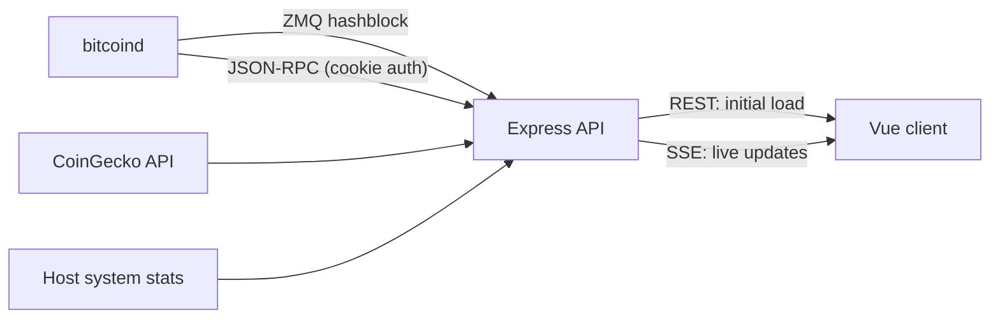

# Walnut

A self-hosted, real-time dashboard for your own Bitcoin full node.

Walnut talks directly to a local `bitcoind` over JSON-RPC and ZeroMQ, turns raw chain data into readable network stats, and pushes live updates to the browser the moment a new block arrives. There are no third-party block explorers involved: everything about the chain comes from your own node.

## Features

The dashboard is split into sections, each refreshed on its own schedule:

| Section           | What it shows                                                                                                   | Updates          |
| ----------------- | --------------------------------------------------------------------------------------------------------------- | ---------------- |
| **Summary**       | Block height, sync progress, chain size on disk, inbound/outbound peers                                         | Every new block  |
| **Fees**          | Estimated fee rates for ~10 min, 1 hour, 1 day, and 1 week confirmation                                         | Every new block  |
| **Mining**        | Coins issued (and % of 21M), block subsidy, blocks until halving, estimated halving date, network hashrate      | Every new block  |
| **Mempool**       | Pending transaction count, minimum relay fee, estimated blocks to clear                                         | Every new block  |
| **Difficulty**    | Current difficulty, blocks to next retarget, projected retarget date and adjustment                             | Every new block  |
| **Next Block**    | Transaction count, total output, subsidy, total fees, and average fee rate of the node's current block template | Every new block  |
| **Latest Blocks** | Recent blocks with age, time between blocks, transaction count, and fullness                                    | Every new block  |
| **Price**         | BTC price, market cap, all-time high, and drawdown (via CoinGecko)                                              | Every 10 minutes |
| **System Status** | Host CPU, memory, temperature, and uptime                                                                       | Every minute     |

Values that change are briefly highlighted in the UI so updates are easy to spot.

## How it works



1. On page load, the client fetches every section in parallel over REST so the dashboard renders immediately.
2. The backend subscribes to the node's `hashblock` ZeroMQ feed. When a new block lands, it recomputes the block-dependent sections and broadcasts them to all connected browsers over Server-Sent Events.
3. Price and system stats are pushed on timers over the same SSE stream.

In production, the Express server also serves the built Vue app, so the whole thing runs as a single Node process alongside your node.

### Implementation details

- **Event-driven, not polled.** Chain data is only recomputed when the node announces a new block over ZeroMQ, which keeps RPC load low.
- **Resilient live connection.** The server sends an SSE heartbeat every 15s and disables proxy buffering. The client runs a watchdog that treats 35s of silence as a dead connection and reconnects with exponential backoff (capped at 30s). It also reconnects when the tab becomes visible again or the network comes back online, which handles laptop sleep and throttled background tabs, cases where `EventSource` keeps reporting `OPEN` on a connection that's actually dead.
- **Derived metrics from raw RPC.** Halving estimates, difficulty-retarget projections (with Bitcoin's 4x adjustment clamp), mempool clearance estimates, and issued supply are all computed from primitive RPC calls. Next-block fees and outputs come from decoding `getblocktemplate` transactions with `bitcoinjs-lib`.
- **Minimal RPC client.** A small typed JSON-RPC client authenticates with `bitcoind`'s cookie file, so no RPC username or password has to be configured.

## Tech stack

- **Frontend:** Vue 3 (Composition API), TypeScript, Vue Router, Vite, Axios
- **Backend:** Node.js, Express, TypeScript, ZeroMQ, Server-Sent Events
- **Bitcoin:** Bitcoin Core JSON-RPC, `bitcoinjs-lib`
- **Other:** `systeminformation` for host metrics, CoinGecko API for price data
- **Tooling:** ESLint, Prettier, Vitest

## Getting started

### Prerequisites

- Node.js 20+
- A running Bitcoin Core node on the same machine, with RPC enabled and the ZeroMQ block hash feed turned on. In `bitcoin.conf`:

  ```ini
  server=1
  zmqpubhashblock=tcp://127.0.0.1:28332
  ```

- A free [CoinGecko](https://www.coingecko.com/en/api) demo API key (optional; only needed for the Price section)

### Configuration

Create `backend/.env`:

```bash
PORT=3000                                       # API port (default 3000)
RPC_PORT=8332                                   # bitcoind RPC port (default 8332)
PATH_TO_COOKIE=/path/to/bitcoin/.cookie         # bitcoind's RPC cookie file
ZMQ_HASH_BLOCK_URL=tcp://127.0.0.1:28332        # must match zmqpubhashblock
COIN_GECKO_API_KEY=your-key-here
DEV_ORIGIN=http://localhost:5000                # allowed CORS origin in development
```

For local development, create `client/.env` so the Vite dev server knows where the API is:

```bash
VITE_API_URL=http://localhost:3000
```

Leave `VITE_API_URL` unset for production builds. The client is served by the API, so requests go to the same origin.

### Install

```bash
cd backend && npm install
cd ../client && npm install
```

### Run in development

Run the API and client in separate terminals:

```bash
cd backend && npm run dev     # API with hot reload on :3000
cd client && npm run dev      # Vite dev server on :5000
```

Then open http://localhost:5000.

### Build and run for production

From the repo root:

```bash
npm run build
```

This builds the client and backend, then starts the server. The app is served at `http://127.0.0.1:<PORT>`. The server binds to localhost only, so to reach it from another device, put it behind a reverse proxy or use an SSH tunnel.

## Project structure

```
walnut/
├── backend/
│   └── src/
│       ├── server.ts            # Express app, static client hosting
│       ├── routes/dashboard/    # REST endpoints + data/metric computation
│       └── services/
│           ├── rpc/             # Typed bitcoind JSON-RPC client
│           ├── zeromq/          # New-block subscriber → triggers updates
│           └── sse/             # SSE client manager + heartbeat
└── client/
    └── src/
        ├── api/                 # REST client + resilient SSE service
        ├── model/               # Reactive dashboard state
        ├── views/               # Dashboard, Explorer, Wallet, Settings
        ├── components/
        └── directives/          # highlight-on-change
```

## Roadmap

The dashboard is fully functional. Other areas are scaffolded and in progress:

- **Explorer:** block and transaction lookup against the local node
- **Wallet:** balances, transactions, and UTXOs
- **Settings:** user preferences (units, temperature scale, etc.)
